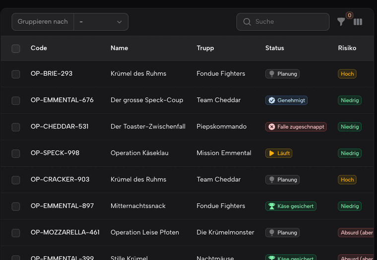

# Peek for Filament

> don't move, just peek

[](https://packagist.org/packages/blemli/peek-for-filament)
[](https://github.com/blemli/peek-for-filament/actions/workflows/tests.yml)
[](LICENSE.md)

Hover any linked record — relationship columns, infolist entries, global search results, breadcrumbs — and a small preview card pops up. Zero configuration: register the plugin and every linked record lights up. Peeks respect your policies (a dedicated `peek()` ability wins, otherwise `view()` applies) and a denial looks exactly like "nothing there".



## Installation

```bash
composer require blemli/peek-for-filament
php artisan peek:install
```

## Usage

```php
$panel->plugin(
    \Blemli\Peek\PeekPlugin::make()
        ->peekDepth(2)     // optional: peeks inside peeks
        ->logActivity(),   // optional: "Stephan peeked at XY" via spatie/laravel-activitylog
);

TextColumn::make('author.name')->noPeeking();          // opt out per column/entry
TextColumn::make('note')->peekable(fn ($r) => $r->author); // force-enable a plain column
```

Custom cards: create `resources/views/peek/{model-kebab}.blade.php`, or register `->peekView(Post::class, 'peek.post')`. Remove everything with `php artisan peek:uninstall` — it deletes what was published and waits until you have taken `->plugin(PeekPlugin::make())` out of your panel provider before offering to run `composer remove` (it never edits your code).

## License

MIT © [blemli](https://github.com/blemli)
